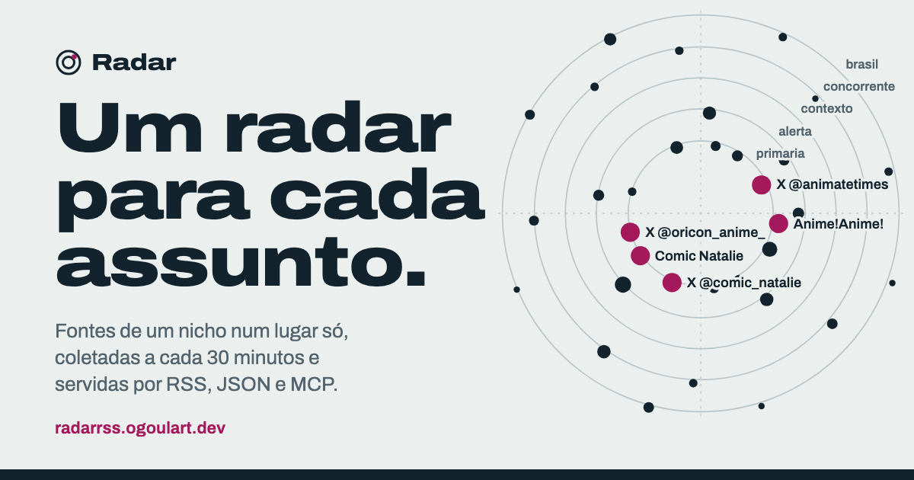

# Radar

**Um radar para cada assunto.** Você junta as fontes de um tema num *nicho* (RSS, rotas do RSSHub, buscas do Google
News, perfis do X), o Radar coleta a cada 30 minutos, avisa quando uma fonte para de responder e entrega o resultado
filtrado por **RSS, JSON e MCP**, pronto para pessoas e para agentes de IA.

No ar em **https://radarrss.ogoulart.dev** (os nichos públicos abrem sem login).



## O que faz

- **Nichos com papéis.** Cada fonte tem um papel (no nicho `anime`: `primaria`, `alerta`, `brasil`, `concorrente`) e um
  peso. Os filtros funcionam por papel, por fonte, por texto e por janela de horas.
- **Público ou privado.** Os nichos nascem privados. Um nicho público pode ser lido por qualquer pessoa sem login e
  copiado para a conta de outra pessoa. O autor só aparece se o dono escolher um nome público.
- **Saúde das fontes.** Cada fonte mostra a última coleta, o erro e o item mais recente, para você ver qual parou.
- **Explorar.** Busca no catálogo de rotas do RSSHub e permite testar uma fonte antes de adicionar.
- **API e MCP.** Tudo o que a interface mostra também sai em JSON e RSS. O MCP tem ferramentas de leitura e de
  escrita, para um agente montar e manter um nicho sozinho.
- **Exportar e importar** um nicho em `.toml` (veja `nichos/anime.toml`).

Em produção, o Radar alimenta a [Shinbun](https://www.instagram.com/plantaoshinbun/), um perfil de notícias de anime
que lê o nicho `anime` para montar as pautas do dia.

## Como é feito

- **Um arquivo, só biblioteca padrão:** `radar.py` usa `http.server`, `sqlite3` e `urllib`, sem dependências.
  Ele faz a interface, a coleta, a API, o MCP e o autoteste.
- **Páginas renderizadas no servidor, sem JavaScript.** A CSP bloqueia scripts (`default-src 'none'`), então as
  animações do escopo são só CSS.
- **Coleta deduplicada:** os itens ficam guardados por URL de feed. Um feed que está em dez nichos é baixado uma vez.
- **[RSSHub](https://github.com/DIYgod/RSSHub)** faz a raspagem das fontes que não têm feed, com Redis de cache.
- **oauth2-proxy** cuida do login com Google. O Radar confia no e-mail que o proxy repassa e não publica porta nenhuma.

```
internet ─► Cloudflare (Worker: cache + limite) ─► oauth2-proxy ─► radar.py ─► RSSHub ─► Redis
```

## Rodar local

```sh
docker compose up -d rsshub        # RSSHub em 127.0.0.1:1200
python3 radar.py                   # interface + coleta a cada 30 min em http://127.0.0.1:1210
python3 radar.py --teste           # autoteste
python3 radar.py --importar nichos/anime.toml --dono voce@exemplo.com --publico
```

No modo local (`RADAR_AUTH=local`, o padrão) existe uma pessoa só e o servidor escuta em 127.0.0.1. Para colocar no ar
com login Google, siga [`deploy/README.md`](deploy/README.md).

## API e MCP

```sh
curl "https://radarrss.ogoulart.dev/api/anime/itens.json?papel=primaria&horas=24"
curl https://radarrss.ogoulart.dev/api/anime.rss
claude mcp add --transport http radar https://radarrss.ogoulart.dev/mcp --header "Authorization: Bearer rk_..."
```

Os nichos públicos não precisam de chave. Para os nichos privados e para escrever, gere uma chave em **Conta**. A
documentação completa, com exemplos de resposta reais, fica em [`/api`](https://radarrss.ogoulart.dev/api).

## Segurança

O Radar baixa URLs que qualquer pessoa logada cadastra, então ele foi tratado como um alvo: um servidor que busca
coisas na internet a pedido de estranhos. Estas são as travas que existem hoje.

### Rede (contra SSRF)

- A coleta e o "testar fonte" só aceitam `http(s)` para **IP público**. Rede privada, `localhost`, o endereço de
  metadados da nuvem (`169.254.169.254`), o Redis e o próprio proxy são recusados.
- A checagem acontece **na hora de conectar**: o Radar resolve o nome, confere o IP e conecta exatamente nesse IP. Isso
  fecha o *DNS rebinding*, em que um domínio responde com IP público na checagem e com IP interno na conexão. O TLS
  continua validando o nome do certificado.
- **Redirecionamentos** passam pela mesma checagem.
- A única exceção é o RSSHub interno, e só no host e na porta exatos dele.
- Cada feed tem teto de **8 MB** e **90 s**.

### Identidade e chaves

- O Radar não publica porta: só o oauth2-proxy fala com ele. Nas rotas públicas o proxy apaga o cabeçalho de
  identidade, então um e-mail forjado não vale nada.
- As chaves de API (`rk_...`) são guardadas **só como hash** (SHA-256) e comparadas em tempo constante
  (`hmac.compare_digest`). A chave aparece uma vez, na hora em que é gerada.
- Rotas do RSSHub que gastam credencial do servidor (X, Instagram) só podem ser cadastradas por administradores.

### Navegador

- Todo `POST` confere o `Origin` (contra CSRF).
- CSP `default-src 'none'`: nenhum script roda, a página não pode ser embutida em iframe (`frame-ancestors 'none'`) e
  formulário só envia para o próprio site. Também vão `X-Content-Type-Options: nosniff` e `Referrer-Policy: same-origin`.
- O cookie de sessão só trafega por HTTPS.

### Abuso e recursos

| Trava | Limite |
|---|---|
| Requisições por IP (login, app, API, MCP) | 120 por minuto na borda; acima disso, `429` |
| Páginas públicas | cache de 60 s na borda, então um pico não chega ao servidor |
| Conta nova | 2 nichos e 20 fontes, até um administrador liberar (`--liberar EMAIL`) |
| Conta liberada | 10 nichos e 100 fontes |
| Copiar nicho | conta no mesmo limite de fontes |
| Testar fonte | 10 por minuto por conta |
| Coletar agora | 1 vez por minuto por nicho |
| Mesmo feed | baixado no máximo 1 vez a cada 10 minutos |
| Corpo de requisição | 100 KB nos formulários, 1 MB no MCP |
| Conexões simultâneas | 48; acima disso, `503` na hora. Socket com timeout de 20 s |
| Containers | radar 256 MB/0,5 CPU, RSSHub 512 MB/1 CPU, Redis 192 MB, proxy 96 MB, todos com `pids_limit` |

Todos os limites mudam por variável de ambiente (`RADAR_LIMITE_*`, `RADAR_CONEXOES`).

### Dados (LGPD)

- O e-mail nunca aparece em página pública. O dono de um nicho público é anônimo por padrão.
- O nicho pode ser exportado em `.toml`, e **Apagar conta** remove tudo da pessoa na hora.
- Os itens ficam guardados por 30 dias. O backup é diário e guarda 7 dias.
- A política fica em [`/privacidade`](https://radarrss.ogoulart.dev/privacidade).

### Limites conhecidos

- Um teto geral de feeds para o servidor inteiro ainda não existe. Hoje, o limite de conta nova é o que impede uma leva
  de contas falsas de transformar o coletor num robô de download.
- Os contadores de "testar" e "coletar agora" ficam na memória do processo. Um restart zera a janela de um minuto.

## Licença

MIT.
